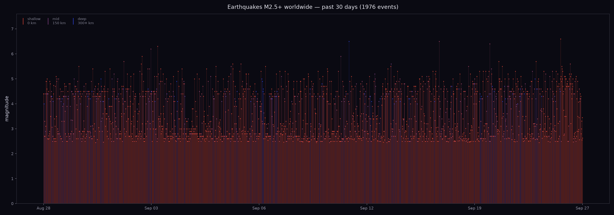

# quakes-this-month

## The phenomenon

The Earth shakes. About 2,000 earthquakes of magnitude 2.5 or larger happen on the planet every month — most are too small to feel, but the planet is never still. I wanted to see what that looks like when all the events from a single month are drawn together on one page, so I fetched the USGS earthquake feed for the last 30 days and plotted every event as a vertical needle.

## The source

The numbers come from the [USGS Earthquake Hazards Program](https://earthquake.usgs.gov/earthquakes/feed/v1.0/summary/2.5_month.geojson), specifically their GeoJSON feed of all M2.5+ earthquakes worldwide in the past 30 days. The file contains about 2,000 events. Each record carries a magnitude, a Unix timestamp in milliseconds, a place name, and three coordinates (longitude, latitude, depth in km). The raw reply is committed to `data/usgs-earthquakes-2.5-month.geojson` exactly as it arrived — the scripts never go online.

## The picture



Each vertical needle is one earthquake. **Height is magnitude**, measured on the y-axis. **Colour is depth** — shallow quakes (close to the surface) glow red, mid-depth ones fade through purple, and deep ones (300 km and below, deep inside the subducting slabs) are blue. Time runs left to right, oldest first. The plot is 1976 individual events drawn on the same dark background so the quiet ones stay quiet and the big ones stand up.

## What the picture shows, and what it hides

In one sentence: there is a constant, thick band of small earthquakes at the base, a sparse canopy of medium spikes above it, and a few tall needles — the rare, powerful events. The eye also catches the blue deep-focus events, which fall in clusters rather than evenly: a hint of where subduction zones are busy.

What this picture throws away: **where**. Latitude and longitude are both dropped. A needle tells you *when* and *how big*, but not *where on Earth*. The 1976 events cluster around tectonic boundaries (the Pacific Ring of Fire, the mid-Atlantic ridge, Indonesia), but a horizontal axis cannot show that — for geography you would need a map. The picture also loses magnitude precision: every event becomes a line of the same thickness, so two M5.4 events drawn side by side look identical, even if one was felt and the other was not. And because the x-axis packs all 30 days evenly, a quiet day looks the same as a busy one; density is not encoded.

## How to run it

```sh
uv run fetch.py    # downloads the GeoJSON once into data/
uv run plot.py     # reads data/, writes out/quakes-this-month.png
```

`fetch.py` will not re-download if `data/` already has the file. The repository runs offline once the data file is committed.